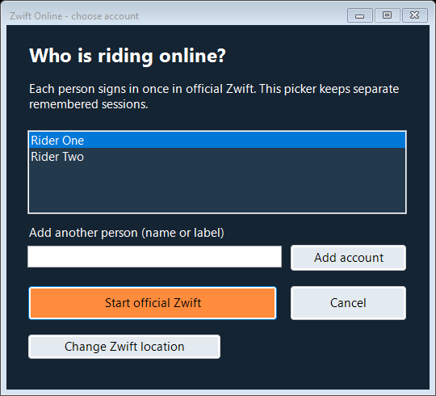

# Zwift Online Account Picker

**For households sharing one Windows PC or laptop:** choose who is riding and
open the official Zwift launcher with that person's separate saved login.
Sign in once per person, then switch accounts without repeatedly logging out
and retyping credentials while those sessions remain valid.

**Local account storage, official online play.** The picker runs on your PC,
stores account labels and separate launcher session folders locally, and has
no telemetry, analytics, external upload service or password-entry form.
You enter your email/password directly into official Zwift. Zwift itself
connects to Zwift's servers for authentication, updates and online riding;
this is not a fully offline version of Zwift.



## Status and version

**Version 0.1.0 — initial standalone release, 2026-11-15.**

Account switching was confirmed working by the user in the original integrated
launcher. This package isolates that picker and launcher logic. Automated
tests verify separate session paths and actual child-process environment
inheritance; independent confirmation on additional PCs is still welcome.

| Feature | Status |
| --- | --- |
| Account selection and Add account | Implemented |
| Separate remembered WebView2 sessions | Implemented; original integration user-confirmed |
| Official launcher path selection/change | Implemented |
| Clean restart scoped to the selected installation/current Windows session | Implemented; dummy-process tests |
| CMD and optional EXE entry points | Included; EXE is produced by Build.ps1 |
| Passwords inside CMD files | Not used |
| Session expiry / official login challenges | Handled by official Zwift; sign in again when requested |
| Offline-server switching, ride uploading and subscription management | Outside this tool's scope |

## Quick start

Requires Windows 10/11, Windows PowerShell 5.1, .NET Framework 4.7.2 or newer,
and the official Zwift app with its WebView2 runtime already installed.
No Python or AutoHotkey is needed.

1. Extract the complete package to a folder you can keep.
2. Double-click **Start Zwift Online.cmd**, or the EXE in a release package.
3. Add a label for each person. The shared package starts with no people.
4. Choose a person and click **Start official Zwift**. Select your actual
   `ZwiftLauncher.exe` the first time; use Change Zwift location to change it.
5. Sign in directly in official Zwift on the first launch for each person.
   Use Remember me when offered and verify the name before starting a ride.
6. On later launches, choose the same person to reuse that local session.

**Save any active ride before switching.** The launcher requests a normal
client close, then stops remaining clients after a grace period. This is a
sequential account switcher, not a simultaneous multi-rider setup.

If an offline tool has redirected Zwift through the Windows hosts file, switch
that tool back to Online first. This picker detects relevant overrides and
stops; it never changes hosts, DNS, certificates or Windows proxy settings.

## How it works / privacy

Each account label maps to a different WebView2 user-data folder. The selected
folder is supplied to the official launcher through the process-scoped
`WEBVIEW2_USER_DATA_FOLDER` variable. The picker restores its previous
environment value after launch. Microsoft documents this
[environment override](https://learn.microsoft.com/en-us/dotnet/api/microsoft.web.webview2.core.corewebview2environment.createasync)
and [separate profile data](https://learn.microsoft.com/en-us/microsoft-edge/webview2/concepts/multi-profile-support).

Data stays under `%LOCALAPPDATA%\ZwiftOnlineAccountPicker\`:

| Path | Contents |
| --- | --- |
| `accounts.json` | Labels and generated local IDs; no email/password fields |
| `profiles/<id>/webview/` | Official launcher's browser data, including session/cookie data |
| `launcher-settings.json` | Chosen local executable path |
| `logs/launcher.log` | Local startup/cleanup diagnostics |

The picker does not transmit this data or send your credentials to another
service. Official Zwift uses its own network services and privacy policy.
Local session data is sensitive: local-only storage is not an extra encryption
or password vault guarantee, and sessions can expire. Do not commit or share
your local data directory. The source/release package contains no user data.

## Build and test

```powershell
powershell.exe -NoProfile -ExecutionPolicy Bypass -File scripts\Build.ps1
powershell.exe -NoProfile -ExecutionPolicy Bypass -File scripts\Test.ps1
```

Build uses the Windows .NET Framework C# compiler. It creates the optional
`Zwift Online Account Picker.exe`; the CMD works from source without compiling.
Tests use temporary dummy launchers and do not log in or upload activities.

## License

GNU Affero General Public License v3.0 (**AGPL-3.0-only**). See [LICENSE](LICENSE)
and [NOTICE](NOTICE). This is an unofficial utility; Zwift and Microsoft
components are installed separately and retain their own licenses.

See [CHANGELOG.md](CHANGELOG.md), [feature status](docs/STATUS.md), and
[architecture](docs/ARCHITECTURE.md) for implementation details and limitations.
